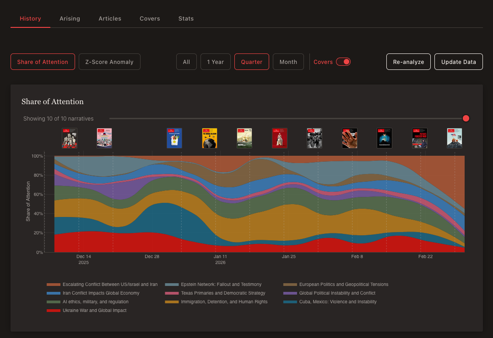
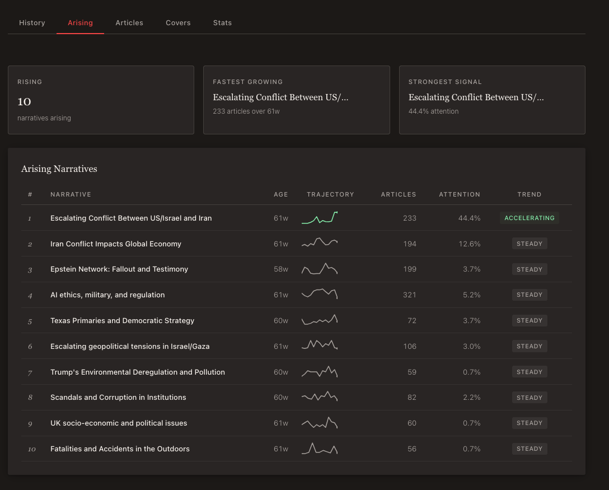
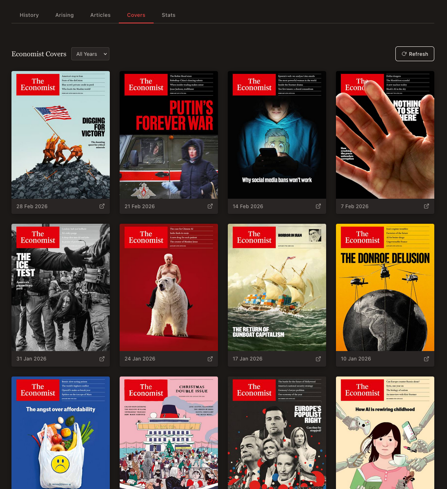
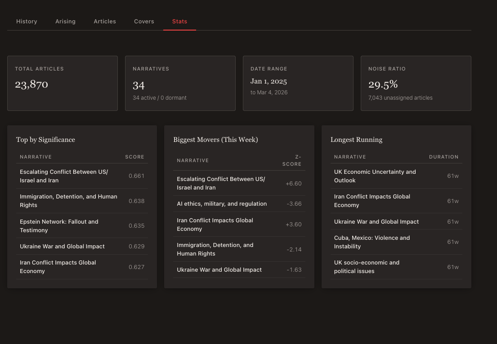

<div align="center">

# Narratio

**What stories are markets telling themselves?**

Track which macro stories dominate headlines from The New York Times and The Guardian, and how their share of attention changes week by week.

[Explore the dashboard](#dashboard) · [Quick start](#quick-start) · [How it works](#how-it-works)



<sub>Timeline view: each band shows a story’s share of headline attention, not a market return.</sub>

</div>

## Quick start

You'll need Python 3.12+, Node.js 20.9+, and three API keys:
- [NYT Archive API](https://developer.nytimes.com/)
- [Guardian Open Platform](https://open-platform.theguardian.com/)
- [OpenRouter](https://openrouter.ai/) (for embeddings + LLM calls)

```bash
# Clone and install
git clone https://github.com/icon3333/narratio.git
cd narratio
uv sync
cd frontend && npm install && cd ..

# Configure your API keys
cp .env.example .env
# Edit .env — you need NYT_API_KEY, GUARDIAN_API_KEY, OPENROUTER_API_KEY

# Run the full pipeline (ingests current month + analyzes)
uv run narratio

# Start the backend API (port 8000)
uv run uvicorn narratio.api:app --reload

# In another terminal — start the frontend (port 3000)
cd frontend && npm run dev
```

Open **http://localhost:3000** and you should see the dashboard.

The first run embeds thousands of headlines. Later runs reuse those embeddings.

## Dashboard

| View | What to look for |
| :--- | :--- |
| **Timeline** | Compare each narrative’s weekly share of attention. Clustering discovers themes without preset categories. |
| **Arising** | Find emerging themes and unusual spikes relative to each story’s own baseline. |
| **Articles** | Search and filter the headlines behind the analysis. |
| **Covers** | Browse and zoom into Economist covers along the timeline. |
| **Stats** | Review coverage and which narratives rank highest by significance, momentum, or longevity. |

Narratio also scores sentiment. Use the REST API to query the data or backfill older headlines to extend the timeline.

<details>
<summary>More dashboard screenshots</summary>

### Arising Narratives

Spot emerging themes early — ranked by article count, attention share, and trend direction with inline trajectory sparklines.

### Articles Database

Browse and search the full headline database across sources.

### Economist Covers

A visual timeline of Economist magazine covers — click to zoom.

### Stats Overview

High-level dashboard metrics: total articles, active narratives, date range, noise ratio, plus leaderboards for significance, momentum, and longevity.

</details>

## How it works

The pipeline runs in roughly this order:

1. **Ingest** — Pull headlines + snippets from NYT and Guardian APIs (not full articles, just headlines — cheaper and faster)
2. **Embed** — Convert each headline into a vector using OpenRouter's embedding API
3. **Filter** — Toss out articles that aren't relevant to macro/finance
4. **Cluster** — Use UMAP to squish the vectors down, then HDBSCAN to group similar headlines together. Each cluster is a "proto-narrative"
5. **Merge** — If two clusters are about the same thing (cosine similarity >= 0.80), combine them
6. **Sentiment** — Score each article's mood using a fast LLM (Gemini Flash)
7. **Label** — Give each narrative a human-readable name like "Fed Rate Cut Expectations"
8. **Analytics** — Calculate share of attention and z-scores for each narrative per week
9. **Summarize** — Generate a story summary describing how the narrative evolved

Everything recalculates across the full history each run, so z-scores and shares stay consistent as the baseline evolves.

## Architecture

| Layer | Stack |
|-------|-------|
| Backend | Python 3.12+ / FastAPI / SQLite (WAL mode) |
| Frontend | Next.js 16 / React 19 / TypeScript / Tailwind 4 / Plotly.js |
| ML | UMAP + HDBSCAN (scikit-learn ecosystem) |
| Embeddings | OpenRouter (`text-embedding-3-small`) |
| LLM | OpenRouter gateway — Gemini Flash for labeling/sentiment, Claude Sonnet for summaries |
| Data | NYT Archive API + Guardian Open Platform |

For the full architecture deep-dive, see `CLAUDE.md`.

## Configuration

Copy `.env.example` and fill in your keys. The main knobs:

| Variable | Default | What it does |
|----------|---------|-------------|
| `NYT_API_KEY` | — | NYT Archive API access |
| `GUARDIAN_API_KEY` | — | Guardian Open Platform access |
| `OPENROUTER_API_KEY` | — | Embeddings + LLM calls |
| `NARRATIO_MIN_CLUSTER_SIZE` | `150` | Minimum articles to form a narrative cluster |
| `NARRATIO_MERGE_THRESHOLD` | `0.80` | How similar clusters need to be to merge |
| `NARRATIO_MATCH_THRESHOLD` | `0.80` | Similarity needed to match a new cluster to an existing narrative |
| `NARRATIO_Z_SCORE_WINDOW` | `8` | Weeks of history for z-score baseline |
| `NARRATIO_MAX_NARRATIVES` | `80` | Cap on tracked narratives |

All models are swappable via env vars — no code changes needed. See `.env.example` for the full list.

## Development

```bash
uv run narratio                                # Full pipeline (current month)
python narratio/backfill.py --start 2025-01    # Backfill historical data
uv run uvicorn narratio.api:app --reload       # API server
cd frontend && npm run dev                     # Frontend dev server
```

## Feedback

Narratio is a side project. If a theme looks mislabeled or a chart doesn’t add up, [open an issue](https://github.com/icon3333/narratio/issues) or send a PR.
